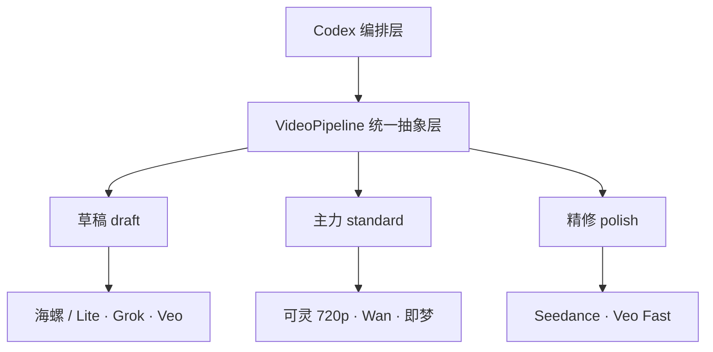

# VideoPipeline：统一镜头请求与分层路由

Codex负责编排镜头、身份参考和现成声音，`VideoPipeline` 提供统一的请求与路由接口。
草稿、主力、精修是用户指定的工作档位，不代表跨厂商的价格或画质排名。



## 配置与接口

`library/video-providers.json` 保存档位内的有序候选。Veo有草稿和Fast精修两个路由配置，
模型、渠道与凭据仍需具体解析；可灵720p配置只接受720p请求。
Hitem3D、Seed3D、Hyper3D属于角色资产准备，不进入视频供应商路由。

`video_pipeline` 包公开：

- `VideoRequest`：镜头ID、动作prompt、时长、比例、分辨率、档位、角色图片和原声音源。
- `ReferenceBinding`：角色、版本、素材ID、真实路径、SHA和图片用途。
- `AudioCueBinding`：现成录音的cue、文件SHA和入出点，安排在后期。
- `ProviderAdapter`：供应商的 `capabilities / prepare / submit / get` 接口。
- `VideoPipeline.plan(request)`：校验本地绑定并评估当前档位，返回可机器读取的离线计划。

```bash
python3 scripts/video-pipeline.py providers
python3 scripts/video-pipeline.py providers --tier standard
python3 scripts/video-pipeline.py plan --request templates/video-pipeline-request.json
python3 scripts/video-pipeline.py plan --request templates/video-pipeline-request.json \
  --tier polish --output production/video-pipeline/naiwa-polish-plan.json
```

模板引用本机已有的Hitem3D奶蛙候选正/侧/背渲图，固定同一版本并保留推断背面限制。
新克隆若缺少这些私有渲图，计划会报告缺项；先从实际本地素材创建自己的请求，
不能将模板中的路径当成已经携带媒体。输出路径已存在时选新文件名，避免覆盖记录。

Python调用示例：

```python
import json
from pathlib import Path
from video_pipeline import VideoPipeline, VideoRequest

request = VideoRequest.from_dict(json.loads(Path('templates/video-pipeline-request.json').read_text()))
plan = VideoPipeline().plan(request)
```

## 规划候选与实际接入分开

当前供应商配置是路由候选，尚未实现对应的联网视频适配器，也未验证各账户的视频权限。
`null` 或空的能力列表表示待核实。计划应显示候选、淘汰原因及未完成项；配置一个名字
或持有其它模型的Key不会使供应商自动可用。

后续接入具体适配器时，继承 `ProviderAdapter` 并显式注入 `VideoPipeline(adapters=...)`。
能力表须对应实际模型和账号支持的图片输入、时长、比例与分辨率。
即使选中了适配器，`plan` 也不调用 prepare/submit/get，不上传图片或产生推理费用。
准备、真实提交、查询与下载由编排层分别执行，并记录任务ID、实际用量和下载结果。
`prepare` 只构造本地请求，不把路径当成已上传附件；POST超时不自动重提。

不因某个供应商不可用就自动升档、换付费模型或退回纯文字生角色。
`generation_allowed` 等输入布尔值不作为授权证明；仍按用户当前指令和具体素材前置处理。

## 身份、原声与验收

每个角色使用同一版本的真实图片；不要把奶蛙原片、社区改绘和不同模型派生图混成同一身份。
文件哈希只证明绑定字节一致，角色匹配与动作稳定性仍按 [identity-lock.md](identity-lock.md) 实看。
AI视频的多角度前置、模型使用范围和实际附件要求保持原项目规则。

声音cue独立绑定现成录音，先按 [audio.md](audio.md) 试听并核定入出点。
供应商自带生成音轨不直接充作奶蛙原作笑声、配音或固定BGM。
更换供应商后仍检查首帧、动作极值、遮挡恢复和尾帧，再按
[editing-language.md](editing-language.md) 完成变焦、卡点、字幕与音轨。

各家官方入口、即梦Visual与Ark凭据区别、Veo渠道和退役版本线索见
`research/video-provider-sources.json`。该文件提供接入证据，实际执行日需解析可用模型与价格。
